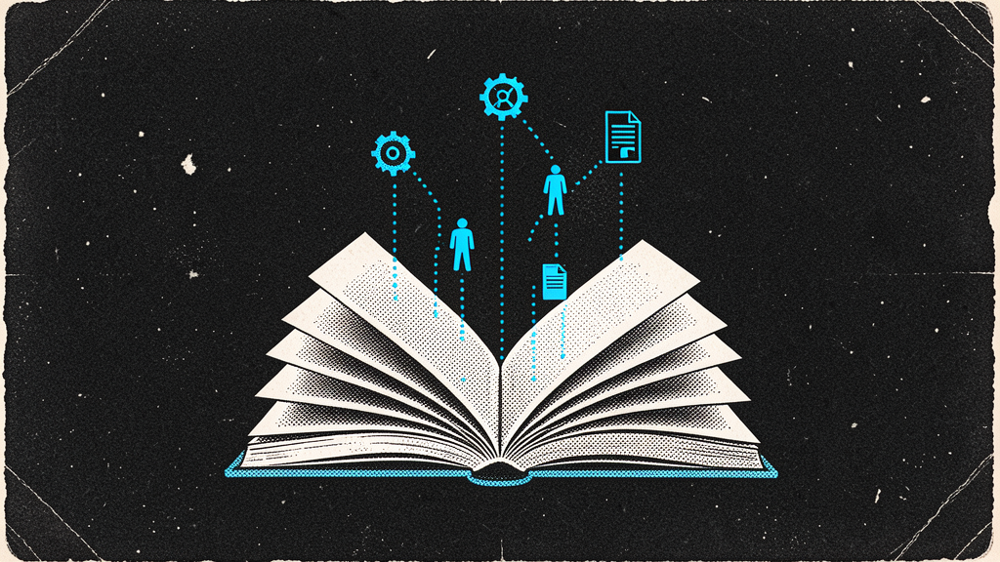

# Senter Agent

> **Senter is the three-eyed owl: a self-documenting, self-extending multi-agent system. The wiki IS the coordination layer.**
>
> Built on [Hermes Agent](https://github.com/NousResearch/hermes-agent) by [Nous Research](https://nousresearch.com/).
> **Bot-first:** every topic is owned by a bot. The bot is the page, the queue, the skill bundle, and the clock.

---

## What is Agent Wiki?

A fleet of bots, one per thing you actually care about, described entirely in
markdown. Each bot owns a topic, carries its own work queue, grows its own
skills, and may run on its own schedule. There is no separate database, no config
dashboard, and no topic directory that exists without an owner.

```
bots/<slug>/
├── BOT.md                  ← identity + dashboard: mission, loop, skills, holds
├── .system/                ← machine coordination (hidden, still editable)
│   ├── continuity.md       ← what the bot understands about its job
│   ├── queue.md            ← [SKILLS] / [LOOPS] / [BOTS] work items
│   └── injections.md       ← one-line status for the human's next conversation
├── skills/<slug>/SKILL.md  ← procedures, loaded on demand
└── loops/<slug>.md         ← a skill bound to a clock
```

Read `BOT_SCHEMA.md` for the standard, and `bots/_fleet/FLEET.md` for the roster.

## Why bot-first

Topic-first wikis rot. A topic page is a filing cabinet: it collects links nobody
executes, and it has no clock, so nothing ever comes due. Bot-first makes every
directory an entity — something you can invoke, that owns a queue, that accretes
skills, and that will notice when it has been idle.

The recursion is the point: **bot-wiki** (Klerik) is the tenth bot. It maintains
the method the other nine run on, using the method itself.

## Quick Start

```bash
# Clone the wiki
git clone https://github.com/SouthpawIN/agent-wiki.git ~/.hermes/wiki

# Parse every bot, propose work
python -m senter_agent ~/.hermes/wiki --json

# Validate the contracts
pytest -q
python scripts/verify_bots.py .            # identity, sections, artifacts, links

# Publish every bot as a Hermes skill (bot-<slug>)
python tools/publish_skills.py . ~/.hermes

# The nightly maintainer
hermes cron create "0 6 * * *" --name fleet-reconcile \
  --prompt "$(sed -n '/## Prompt/,/## Stop/p' ~/.hermes/wiki/bots/bot-wiki/loops/fleet-reconcile.md)"
```

Each bot maps 1:1 onto a Hermes **profile**, so Hermes **Bot Mode** shows the same
roster with per-bot memory, skills, and routines. The wiki is the design doc; the
profile is the runtime.

## The Four Primitives

| Primitive | Factory | What It Is |
| --- | --- | --- |
| **Bot** | Agents | An owned topic: identity, mission, holds, and a clock |
| **Context** | Context | Wiki pages — raw understanding, structured into knowledge |
| **Skills** | Skills | `SKILL.md` bundles — procedures, loaded on demand |
| **Loops** | Loops | A skill plus a schedule; cron or kanban |

Primitives nest: a **Bot** holds **Context**, runs **Loops**, and loads **Skills**.

## The Flywheel

1. **Chat** — you tell Senter about an idea.
2. **Comprehend** — Context writes the bot's `.system/continuity.md`.
3. **Shape** — a bot appears: `BOT.md` with a mission, three skills, one loop.
4. **Execute** — the loop runs, writes artifacts, appends to the bot's log.
5. **Inject** — one line comes back to you in conversation, not a dashboard.

## The Bot Is the Topic

There is no `topics/` tree. If a bot needs two missions it is two bots; if a topic
has no bot it is an idea, not a project. The rules that follow from that:

| Rule | Why |
|---|---|
| One bot, one topic | Two missions means neither gets a clean queue |
| Skills are procedures | A description cannot be executed by a fresh agent |
| Loops name their skill | An unbound loop is a mystery cron job |
| Hold points are absolute | Payment, publishing, and filings need a human |
| `blocked` needs a named ask | A stuck bot with no ask is a dead bot |

## The Factory Pipeline

| Factory | Watches | Produces |
| --- | --- | --- |
| **Context** | chat sessions | wiki pages, queue items |
| **Skills** | `[SKILLS]` items | `SKILL.md` files |
| **Agents** | `[BOTS]` items | bot scaffolding, profiles |
| **Loops** | `[LOOPS]` items | cron jobs, kanban tasks |

All factories use the same four stages: **Collect evidence → Generate candidates
→ Evaluate → Apply.** They materialize reviewable markdown; they never silently
create live Hermes objects.

## Global Catalogs

| Catalog | Shows |
| --- | --- |
| [[bots/_fleet/FLEET\|Fleet]] | all nine bots, status, blockers |
| [[catalogs/bot-roster\|Bot Roster]] | every bot → its Hermes profile |
| [[catalogs/skill-registry\|Skill Registry]] | every skill, by bot |
| [[catalogs/loop-registry\|Loop Registry]] | every loop, schedule, state |
| [[catalogs/agent-roster\|Agent Roster]] | the front door (Senter) and roles |

## Design Principles

1. **Markdown is the API** — human ↔ machine, machine ↔ machine.
2. **The wiki is the system** — no separate database or config dashboard.
3. **User-editable everything** — every understanding, queue item, and status.
4. **Dot-prefix for machine internals** — `.system/` is hidden but accessible.
5. **Bots are self-contained** — each holds its own context, skills, and loops.
6. **Factories are thin** — a cron job that spawns one `delegate_task`.
7. **Injections keep you in the loop** — factories write files; conversation reads them.
8. **No self-edit** — the bot that writes bots cannot rewrite itself.

## Integrated Verification

System status and the user-test matrix live in [[INTEGRATED_STATUS.md|INTEGRATED_STATUS.md]].
The live wiki is `~/.hermes/wiki/`; conventions in `BOT_SCHEMA.md`; history in `log.md`.

## Learn More

- [[BOT_SCHEMA\|Bot Schema]] — the standard every bot is written against
- [[spec\|Agent Wiki Specification]] — full architecture
- [[goop-whitepaper\|GOOP Whitepaper v1]] — the original vision
- [[goop-nesting\|GOOP Nesting]] — primitive nesting

---

_Built on [Hermes Agent](https://github.com/NousResearch/hermes-agent). Towards Self-Improvement._
