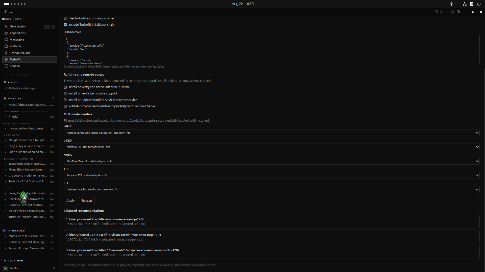
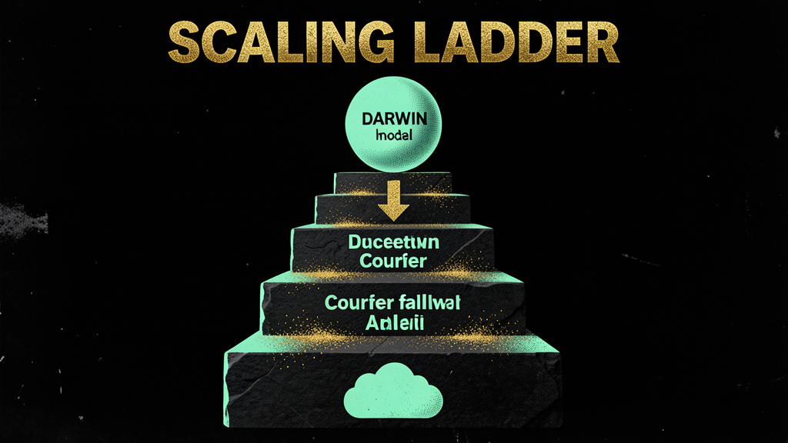
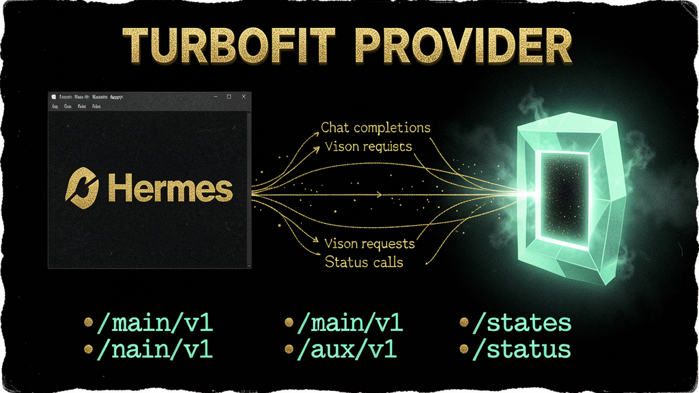
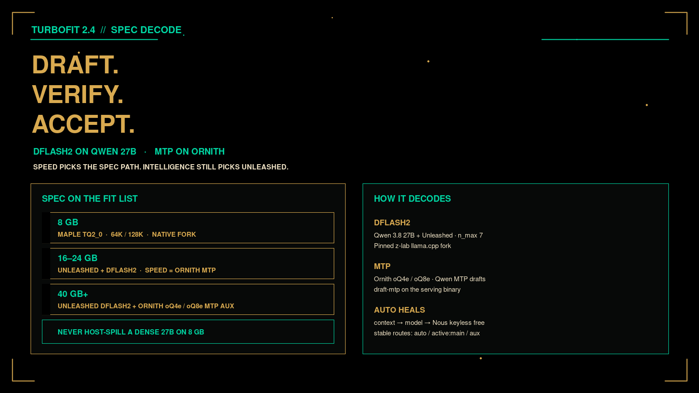

# TurboFit

**One model provider. Every machine. The best local configuration the hardware can safely sustain.**

TurboFit is a first-class [Hermes Agent](https://github.com/NousResearch/hermes-agent) provider and adaptive local-inference runtime. It inventories your physical compute and total usable memory, recommends an evidence-backed **Fit Ladder**, launches a native backend, and exposes one OpenAI-compatible endpoint. Pick the `auto` model and it fits the largest model your machine can sustain — with a measured, reproducible fallback if a rung can't hold.

> **TurboFit is the whole project. TurboSouth is the dedicated service-tech bot** that helps you install it, land it on a machine that's never been tested, configure it, answer questions, and send tested fixes back upstream to TurboFit.

---

## Install

The fastest path — **paste this into your Hermes** and it does everything: installs + enables TurboFit, sets it as your provider with the `auto` model, installs TurboSouth, and selects the sovthpaw pet.

> Install and enable TurboFit from https://github.com/SouthpawIN/turbofit.git, set it as my provider with the auto model, install TurboSouth, and select the s0uthpaw pet as my default.

Prefer a specific route? All five are supported.

| Option | How |
|--------|-----|
| **Hermes prompt** (recommended) | Paste the one-liner above — your Hermes installs, enables, configures, and selects the pet. |
| **Plugin** | `hermes plugins install --enable https://github.com/SouthpawIN/turbofit.git` |
| **TurboSouth** (bot installs TurboFit) | `hermes profile install https://github.com/SouthpawIN/turbosouth.git` |
| **Hermes Desktop** | **Turbofit** sidebar → primary + fallback + **Install or update bundled TurboSouth** → Apply |
| **Manual** | `git clone https://github.com/SouthpawIN/turbofit.git` → follow `after-install.md` |

### After install (any path)
1. Quit Hermes Desktop (⌘Q) and open a new session.
2. `/turbofit status` → `/turbofit setup`.
3. The sovthpaw pet is selected for you (or run `hermes pets select s0uthpaw` manually).

---

## The two fit ladders

`serve auto` picks the largest rung your machine can hold, then falls back measurably. Two independent ladders, chosen by your hardware:

**Ladder 1 — GPU-dedicated** (a VRAM ceiling, e.g. RTX 3090 24 GB). Dense and MoE models sized to the card:

`Qwen3.5-397B-A17B` (MoE, 17 B active) → `GLM-5.1` (744 B MoE, 40 B active, strongest local coder) → `Qwen3.5-27B` (dense) → `Llama-3.3-70B` (dense) → `Qwen3-30B-A3B` (MoE, 3 B active) → `Qwen2.5-72B-Instruct-1M` (8448-ctx dense)

**Ladder 2 — Unified memory** (Mac / Apple Silicon, no VRAM ceiling). MoE is the practical path:

`Qwen3-30B-A3B` (MoE, 3 B active) → `Qwen3.5-35B-A3B` (MoE, 3 B active, 1 M ctx always-on)

**When VRAM pressure rises, recover in this order:** the main model is protected until the last step · MoE expert offload is the first pressure valve · context drops only when absolutely necessary · API aux kicks in when the local aux can't fit.

> Deep detail: [`references/fit-ladder.md`](references/fit-ladder.md) · Canonical data: [`fit-lists.json`](https://github.com/SouthpawIN/turbofit/blob/main/fit-lists.json) and [`model-catalog.json`](https://github.com/SouthpawIN/turbofit/blob/main/model-catalog.json).

---

## Model lineup

Ranked by **measured evidence, not heuristics** — three layers:

- **Local fit-ladder models** — the two ladders above (the downloadable models Turbofit actually fits).
- **API lineup** — for Modest/Thin machines: `DeepSeek V4 Pro` (NIM, free, top open SWE-bench), `Qwen 3.7 MAX` (paid, #1 MMLU), `MiniMax M3` (NIM, free, vision, 1 M ctx) as the aux.
- **Named local picks** — MRI-Trust merges and MTP grafts: `Darwin 28B Reason` (89.4 % GPQA, smartest dense), `Prism Eagle 27B` (121 tok/s, fastest), `Carnice 35A3B` (small aux).

**Pairing rules:** a text-only main **must** pair with a vision aux (never two blind models) · the aux offsets 40–85 % of token cost · the aux needs 262 K+ context to compress the main without losing info · free NIM pairs beat everything on cost.

> Deep detail: [`references/model-lineup.md`](references/model-lineup.md) · [`references/benchmark-evidence.md`](references/benchmark-evidence.md)

---

## TurboSouth — your TurboFit service tech

TurboSouth is the dedicated, self-updating customer-service bot for TurboFit. It's not a second model backend — it's the hands that get you from *"I have a machine"* to *"TurboFit is running the best model it can"* — and it keeps feeding improvements back upstream.

Installing TurboSouth **defaults to the sovthpaw pet** (`s0uthpaw`) — a chibi agent with big curly auburn hair, black sunglasses, a sleeveless black vest, and a pink strap — for both the default home and the TurboSouth profile.

What TurboSouth helps with:
- **Install + setup** — resolves the right Auto-chain artifacts for your machine and gets the gateway up.
- **Landing on an untested machine** — evidence-based machine-fit comparison before committing to a rung. It shows the math; it never guesses.
- **Configure** — hardware profile, primary vs. fallback chain, Tailscale exposure.
- **Answer questions** — Q&A grounded in the wiki, with citations (not vibes).
- **Troubleshooting** — `status`, `smoke`, `health`, and gateway checks.
- **Send tested upstream PRs** — evidence-backed pull requests to TurboFit (never an autonomous publish).

What it does *not* do: autonomously publish PRs, manage credentials, kill external GPU processes, or bypass the native runtime lifecycle.

> Reciprocal install: `hermes profile install https://github.com/SouthpawIN/turbosouth.git` · In-product: `install_turbosouth: true` (via `/turbofit` or the Desktop settings).

---

## Multimodal status

Local multimodal is the **hard frontier** — MoE + a vision tower + 300 K+ context doesn't fit one GPU today.

- **Vision aux** (image understanding) ships now: pair a text-only main with `MiniMax M3` or `qwen3-vl-8b-instruct-v2` (76.3 %).
- **TTS + STT** run through the same gateway.
- **Full local multimodal** (image/video/music on-device) is the 2-GPU job — `Qwen3-Next-80B-A3B` (3.4 tok/s, 300 K ctx) needs ~2× 40 GB; the small always-on multimodal is `Qwen2.5-Omni-3B` (49 tok/s, 3 B).

> Deep detail: [`references/multimodal.md`](references/multimodal.md)

---

## Benchmarks (what we've measured, and the gaps)

- **External (discovery only):** DeepSWE v1.1 (113 tasks). The only local Turbofit candidate on it is `glm-5-2-2-788bpw` — 0.438 pass@1 → **78.8 bpw**, a 2× jump over the previous local baseline.
- **Local (the gap):** most local benchmark numbers are still missing. The only measured local numbers recorded: `GLM-5.1` at 1.75 tok/s on M1, `Qwen3-30B` 8.3 tok/s, `Qwen3.5-35B-A3B` 4.4 tok/s. The "all dashes" in the local tables is the **#1 evidence gap** — local candidates aren't yet benchmarked at Tier-S standard.
- **Pending:** DeepSpec (39.1 tok/s draft, 1.77× on 3090) and DeepSWE 2.0.

External results are discovery evidence only; a model is promoted to a local runtime profile only after a reproducible local run passes its gates.

> Deep detail: [`references/benchmark-evidence.md`](references/benchmark-evidence.md)

---

## Tailscale

- **Gateway binding:** the box runs the Hermes Gateway on `0.0.0.0:8091`; Tailscale exposes it on the tailnet (Mac: launchd `com.hermes.turbofit-gateway`; Omarchy: systemd user units).
- **Model-picker federation:** peers auto-discover over the tailnet — each box advertises the models it can serve.
- **The end state:** the wiki itself becomes the single source of truth, centralized over Tailscale across all devices, organized top-down by the wiki's own standards.

> Deep detail: [`references/tailscale.md`](references/tailscale.md)

---

## What you get

- **Fit Ladder** — the two ladders above, with a measured reproducible fallback.
- **Multimodal adapters** — vision aux, TTS, and STT through the same gateway (full on-device multimodal is the frontier).
- **Tailscale Serve** — private remote access (`/turbofit serve`, verify with `/turbofit smoke`). Funnel is never used.
- **Native engines** — CUDA, ROCm, Vulkan, Metal, and CPU backends chosen by your hardware.

---

## Troubleshooting & upstream

- **Troubleshooting** — VRAM OOM (walk the ladder, don't just restart), the local-benchmark gap, gateway reachability, blind-aux pairing. → [`references/troubleshooting.md`](references/troubleshooting.md)
- **Upstream PR process** — TurboSouth converts recurring, evidence-backed support problems into PR *suggestions*; a real PR opens only with human approval, against the exact upstream, evidence attached. → [`references/upstream-pr-process.md`](references/upstream-pr-process.md)

---

## Where the deep data lives

This entry is the overview. The full evidence is one level down:

- [`references/`](references/) — `fit-ladder.md`, `model-lineup.md`, `benchmark-evidence.md`, `hardware-tiers.md`, `multimodal.md`, `tailscale.md`, `troubleshooting.md`, `upstream-pr-process.md`
- [`wiki/index.md`](wiki/index.md) — the generated public wiki (Model Zoo, benchmarks, fit ladders)
- [`ROADMAP.md`](ROADMAP.md) — the source-of-truth roadmap (the two ladders, phases, open gaps)
- Canonical data in the product repo: [`fit-lists.json`](https://github.com/SouthpawIN/turbofit/blob/main/fit-lists.json) · [`model-catalog.json`](https://github.com/SouthpawIN/turbofit/blob/main/model-catalog.json)

---

## Visual reference

## License

MIT
